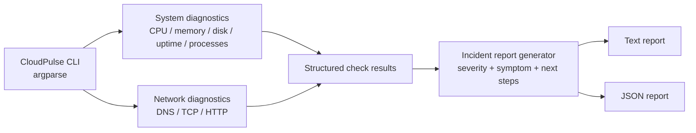
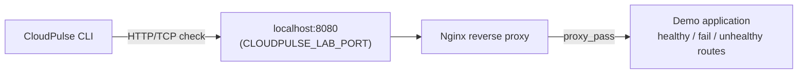

# Architecture and design notes

## Diagram

## Data flow

`cli.py` validates user input (including `--url` scheme and `--tcp` HOST:PORT syntax) and calls
`run_diagnostics()`. `checks.py` returns one JSON-compatible dictionary per check -- a `status`
(`ok`/`warning`/`error`/`unsupported`) plus whatever was actually measured. Linux host metrics are
parsed from `/proc`; disk usage uses `shutil`. `report.py`'s `build_incident()` wraps that raw list
into a full incident: an `incident_id`, a `host` block, and -- per check -- a `severity`
(`info`/`warning`/`critical`), and for anything not plain-`ok`, a `symptom` string and a list of
`next_steps`. `to_text()`/`to_json()` render that incident. `main()` exits `0` when
`overall_status` is `healthy`, `1` otherwise, `2` on a usage error (via `argparse`).

## Why checks and reporting are separate modules

`checks.py` only reports what was observed: a CPU percentage, a DNS result, an HTTP status code.
It has no opinion about whether that observation matters. `report.py` is where severity,
human-readable symptoms, and investigation next-steps are assigned -- deliberately kept out of
`checks.py` so a check's "did this succeed" logic never gets tangled with "how bad is this and
what should you do about it" logic. This also means `checks.py` is independently testable (does
the DNS check handle `OSError` correctly?) from `report.py` (does an `error` status map to
`critical` severity with a non-empty `next_steps` list?).

## Failure handling

DNS, TCP, and HTTP checks catch expected network exceptions and return the exception text with an
`error` status. The disk check catches `OSError` from an invalid path the same way, rather than
letting it propagate as a crash. TCP and HTTP operations use finite timeouts (3s/5s by default).
Process enumeration skips processes that exit or deny access during collection
(`OSError`/`AttributeError`/`ValueError`, since a vanished `/proc/<pid>` entry can fail in any of
those ways depending on which read lost the race). Metrics are observations; the only thresholds
applied are a 90% warning for CPU, memory, and disk -- there is no latency threshold yet (see
"Future improvements" below).

CloudPulse's own `check_http`/`check_tcp` timeouts (5s/3s) are shorter than Nginx's default
`proxy_connect_timeout` (60s) in the failure lab. Without tuning Nginx's timeout down (see
`simulation/nginx.conf`), the HTTP check would still correctly time out and report an error -- but
the *lab itself* would take up to 60s to produce a response, which is why the lab's Nginx config
sets a 3s `proxy_connect_timeout` independently of CloudPulse's own timeout handling.

## The Docker image vs. the failure lab

These are two separate, unrelated images, both present in this repo:

- **`Dockerfile`** (root): packages the CloudPulse CLI itself as a distributable artifact. Two
  stages -- a `builder` that installs the package into a venv, and a slim runtime stage that
  copies just that venv and runs as a non-root user (uid 10001). This is what gets published to
  GHCR (see [DEPLOYMENT.md](DEPLOYMENT.md)).
- **`simulation/app/Dockerfile`**: builds the throwaway demo HTTP server used only by the local
  failure-simulation lab. It is never published anywhere; it exists purely as a target for
  CloudPulse to diagnose.

## Boundaries

The tool inspects the machine where it runs. It does not SSH to remote systems, collect logs,
infer root cause, or persist reports unless the user specifies an output path. The Docker lab is
an isolated local target bound to `127.0.0.1`, and demonstrates observable symptoms (500, 503, and
a proxy-to-dead-upstream failure that this environment surfaces as 504 -- see
[TROUBLESHOOTING.md](TROUBLESHOOTING.md) for exactly what was observed and why).

CloudPulse does not run continuously or alert anyone (one report per invocation), does not support
Windows/macOS for CPU/memory/process checks (they report `unsupported` rather than fabricating
numbers), and does not deploy to any cloud provider -- see [DEPLOYMENT.md](DEPLOYMENT.md) for what
"deployment" means for a CLI tool like this.

## Future improvements

- A `psutil`-based fallback (optional extra, not a hard dependency) so CPU/memory/process checks
  work cross-platform instead of Linux-only.
- A configurable latency threshold for the HTTP/TCP checks (currently only CPU/memory/disk have
  warning thresholds).
- A `--config` file for repeatable check sets, instead of repeating flags on every run.
