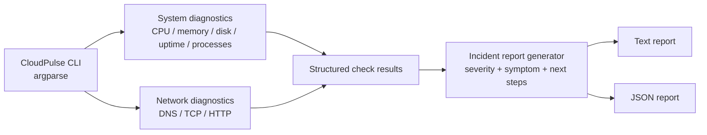
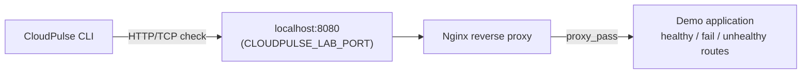

<p align="center">
  
</p>

<p align="center">
  <a href="https://github.com/udayramageri09/cloud-pulse/actions/workflows/ci.yml"></a>
  <a href="https://github.com/udayramageri09/cloud-pulse/actions/workflows/docker-image.yml"></a>
  
  <a href="LICENSE"></a>
</p>

CloudPulse is a small Python CLI that performs first-response Linux host and network diagnostics
-- the same kind of checks a support/SRE engineer runs in the first few minutes of an incident --
and writes the result as a structured incident report (text or JSON). It has no dependencies
beyond the Python standard library, and it inspects only the machine it runs on.

## Why this exists

When something is down, the first questions are always the same: is the host healthy, can the
network reach the target, and what is the actual observed symptom (not yet the root cause).
CloudPulse automates asking those questions consistently, so the first few minutes of an
investigation produce a structured record instead of a handful of manually run commands you
have to remember and interpret.

## Key features

- **Host diagnostics:** CPU, memory, disk usage, uptime, and the top processes by memory use,
  parsed from Linux `/proc` -- no `psutil`, no native extensions.
- **Network diagnostics:** DNS resolution, TCP connectivity, and HTTP/HTTPS status + latency,
  each with a finite timeout and clean error handling (no stack traces for expected failures).
- **Incident reports, not just logs:** every run gets an incident ID, host info, a severity
  classification per check (`info`/`warning`/`critical`), an observed symptom, and suggested next
  investigation steps -- never a fabricated root cause.
- **Honest about platform limits:** CPU/memory/process checks report `unsupported` on non-Linux
  hosts instead of inventing numbers.
- **A real failure lab:** a Docker Compose environment (demo app + Nginx) to safely reproduce and
  observe 200/500/503/504 scenarios on your own machine.

## Demo video

A ~3 minute walkthrough covering the CLI, the failure-simulation lab, and the incident report
format: see [`demo-video/`](demo-video/) for the rendered video and its production notes
(narration script, storyboard, and exactly how it was built).

## Architecture





Checks (`checks.py`) report observed facts only. Severity classification, symptoms, and next-step
suggestions (`report.py`) are computed from those facts afterward -- the two responsibilities are
deliberately kept separate so the tool never conflates "what happened" with "what to do about it."
See [ARCHITECTURE.md](ARCHITECTURE.md) for more detail.

## Technology stack

Python 3.10+ (standard library only: `argparse`, `socket`, `urllib`, `shutil`, `pathlib`) for the
CLI; Docker Compose + Nginx + a small stdlib HTTP server for the failure lab; GitHub Actions for
CI and Docker image builds; `unittest` for tests.

## Installation

```bash
python -m venv .venv && source .venv/bin/activate   # .venv\Scripts\Activate.ps1 on Windows
python -m pip install -e .
```

Or run it in a container without installing anything locally:

```bash
docker build -t cloudpulse:local .
docker run --rm cloudpulse:local --url https://example.com
```

Full install/distribution options (Docker image, GHCR, Codespaces, releases) are in
[DEPLOYMENT.md](DEPLOYMENT.md).

## Quick start

```bash
cloudpulse --dns example.com --tcp example.com:443 --url https://example.com
cloudpulse --format json --output incident.json --dns example.com --url https://example.com
cloudpulse --verbose   # host-only report, no network access needed
```

Exit code is `0` when `overall_status` is `healthy`, `1` when it is `degraded`/`critical`, and `2`
on a usage error (invalid arguments).

## Example output

Actually captured from a run of this CLI against the failure-simulation lab described below
(trimmed; full captures are in [`captures/`](captures/)):

```text
CloudPulse Incident Report
Incident ID: CP-20261105123430-ca25b8
Generated: 2026-11-05T12:34:30.610992+00:00
Host: UdayRam (Windows-11-10.0.26200-SP0, Python 3.12.10)
Overall status: HEALTHY
Checks: 8 total - 8 info, 0 warning, 0 critical

[INFO] system - platform=Windows-11-10.0.26200-SP0, python=3.12.10, uptime_seconds=None
[INFO] cpu - usage_percent=None, logical_cores=18, detail=CPU utilization is currently implemented for Linux /proc/stat.
[INFO] disk - path=C:\, usage_percent=51.8, free_bytes=238986928128, total_bytes=495687036928
[INFO] dns (example.com) - addresses=['104.20.23.154', '172.66.147.243'], duration_ms=13.3
[INFO] tcp (127.0.0.1:18080) - duration_ms=0.98
[INFO] http (http://127.0.0.1:18080/health) - http_status=200, duration_ms=42.94
```

And the same target after the app container is stopped:

```text
[CRITICAL] http (http://127.0.0.1:18080/health) - http_status=504, error=HTTP Error 504: Gateway Time-out, duration_ms=3041.71
    Symptom: http (http://127.0.0.1:18080/health) failed: HTTP Error 504: Gateway Time-out
    Next step: Compare with the TCP result: a reachable port with a failing HTTP response points at the application or proxy, not the network path
    Next step: Inspect application/proxy logs to distinguish a gateway error from an application error
```

## Docker simulation lab

A local, isolated environment (bound to `127.0.0.1` only) for safely reproducing real failure
symptoms:

```bash
./simulation/lab.sh up       # bash/WSL/macOS/Linux
./simulation/lab.ps1 up      # Windows PowerShell
cloudpulse --url http://127.0.0.1:8080/health --tcp 127.0.0.1:8080
```

If port 8080 is already in use on your machine, set `CLOUDPULSE_LAB_PORT` (e.g. `18080`) before
running `up`.

## Failure investigation scenarios

| Scenario | Command | What CloudPulse actually observed (verified live) |
|---|---|---|
| Healthy | `./simulation/lab.sh up` | `http_status: 200`, `overall_status: healthy` |
| App down (proxy can't reach upstream) | `./simulation/lab.sh stop-app` | TCP `ok`, HTTP `504 Gateway Time-out` after ~3s |
| Application error | check `.../fail` | HTTP `500 Internal Server Error` |
| Unhealthy endpoint | `./simulation/lab.sh unhealthy` | HTTP `503 Service Unavailable` |

Full walkthrough with real Nginx/app logs for each case: [TROUBLESHOOTING.md](TROUBLESHOOTING.md).
Reset to baseline any time with `./simulation/lab.sh reset`.

## Testing

```bash
python -m pip install -e .
python -m unittest discover -s tests -v
```

13 tests cover check classification (severity/symptom assignment), report rendering (text/JSON),
CPU/disk edge cases (warning threshold, invalid path), and network-failure handling via mocks.
GitHub Actions runs this suite plus a CLI smoke check on every push; see
[`.github/workflows/ci.yml`](.github/workflows/ci.yml).

## Project structure

```text
src/cloudpulse/     CLI, checks, and report rendering
tests/              unittest suite
simulation/         failure-lab demo app, Nginx config, lab.sh/lab.ps1
.devcontainer/      Codespaces / Dev Container config
.github/workflows/  CI and Docker image build/publish
Dockerfile          CloudPulse CLI image (multi-stage, non-root)
demo-video/         video script, storyboard, and render pipeline
screenshots/        genuine captured CLI/test/lab output, rendered as images
```

## Limitations

This is a diagnostic aid, not a monitoring platform. It does not:

- Run continuously or alert -- it produces one report per invocation.
- Collect logs from remote hosts, or SSH anywhere -- it only inspects the machine it runs on.
- Determine root cause -- it reports observed facts, severity, and suggested next steps.
- Deploy to any cloud provider -- see [DEPLOYMENT.md](DEPLOYMENT.md) for what "deployment" means
  for a CLI tool like this.
- Support Windows/macOS for CPU, memory, or process checks -- these report `unsupported` rather
  than fabricating numbers (disk and all network checks work everywhere).

## Future improvements

- Linux-only CPU/memory/process checks could gain a `psutil`-based fallback for cross-platform
  support, as an optional extra rather than a hard dependency.
- A configurable latency threshold for the HTTP/TCP checks (currently only memory/disk/CPU have
  warning thresholds).
- A `--config` file for repeatable check sets, instead of repeating flags each run.

## License

[MIT](LICENSE).
