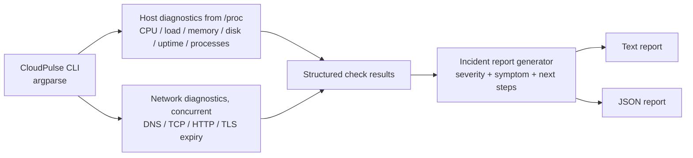
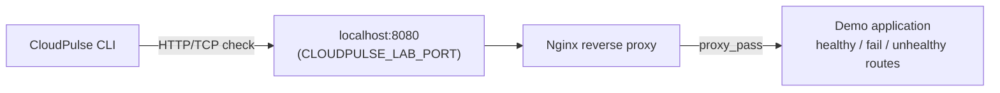

# Architecture and design notes

## Diagram

## Data flow

`cli.py` validates user input (including `--url` scheme and `--tcp` HOST:PORT syntax) and calls
`run_diagnostics()`. `checks.py` returns one JSON-compatible dictionary per check -- a `status`
(`ok`/`warning`/`error`/`unsupported`) plus whatever was actually measured. Linux host metrics are
parsed from `/proc`; disk usage uses `shutil`. `report.py`'s `build_incident()` wraps that raw list
into a full incident: an `incident_id`, a `host` block, and -- per check -- a `severity`
(`info`/`warning`/`critical`), and for anything not plain-`ok`, a `symptom` string and a list of
`next_steps`. `to_text()`/`to_json()` render that incident. `main()` exits with the Nagios plugin convention
so CloudPulse can run as a monitoring check or CI gate: `0` healthy, `1` degraded, `2` critical,
`3` unknown (invalid arguments). argparse's own usage-error code (2) is remapped to 3, otherwise a
typo on the command line would look like a critical outage to a monitoring system.

## Reading /proc

Host checks take the `/proc` location as a parameter (default `/proc`, or `CLOUDPULSE_PROC_ROOT`).
That one seam lets the parsers run against a fake `/proc` tree in `tests/fixtures/proc` on any OS.
CPU utilisation needs two samples of `/proc/stat` because its counters are cumulative since boot;
utilisation is `1 - delta(idle + iowait) / delta(total)`. Memory uses `MemAvailable`, not `MemFree`
(free memory ignores reclaimable page cache and overstates pressure). Load average is reported per
logical core, because a load of 4 is saturation on 4 cores but light on 16.

## Network checks run concurrently

DNS, TCP, HTTP and TLS checks spend almost all their time waiting on the network, so
`run_diagnostics()` runs them in a `ThreadPoolExecutor`. A report takes as long as the slowest
check instead of the sum of all timeouts; `map()` keeps results in a fixed order. Threads (not
processes) are the right tool here: the GIL is released while a thread waits on a socket.

## TLS certificate checks

For an `https://` URL, `check_tls` does a fully verified handshake (system CA store, hostname
check) and reports days until the leaf certificate expires, warning under 14 days
(`--tls-warn-days`). An expired, self-signed or wrong-hostname certificate fails verification and
is reported as an error with OpenSSL's reason.

## Why checks and reporting are separate modules

`checks.py` only reports what was observed: a CPU percentage, a DNS result, an HTTP status code.
It has no opinion about whether that observation matters. `report.py` is where severity,
human-readable symptoms, and investigation next-steps are assigned -- deliberately kept out of
`checks.py` so a check's "did this succeed" logic never gets tangled with "how bad is this and
what should you do about it" logic. This also means `checks.py` is independently testable (does
the DNS check handle `OSError` correctly?) from `report.py` (does an `error` status map to
`critical` severity with a non-empty `next_steps` list?).

## Failure handling

DNS, TCP, and HTTP checks catch expected network exceptions and return the exception text with an
`error` status. The disk check catches `OSError` from an invalid path the same way, rather than
letting it propagate as a crash. TCP and HTTP operations use finite timeouts (3s/5s by default).
Process enumeration skips processes that exit or deny access during collection (`OSError` or
`ValueError`, depending on which read lost the race) and kernel threads, which have no `VmRSS`.
Thresholds: 90% for CPU, memory and disk (`--cpu-warn`, `--mem-warn`, `--disk-warn`), load above
1.0 per core, and TLS expiry under 14 days. There is no latency threshold yet (see "Future
improvements" below).

CloudPulse's own `check_http`/`check_tcp` timeouts (5s/3s) are shorter than Nginx's default
`proxy_connect_timeout` (60s) in the failure lab. Without tuning Nginx's timeout down (see
`simulation/nginx.conf`), the HTTP check would still correctly time out and report an error -- but
the *lab itself* would take up to 60s to produce a response, which is why the lab's Nginx config
sets a 3s `proxy_connect_timeout` independently of CloudPulse's own timeout handling.

## The Docker image vs. the failure lab

These are two separate, unrelated images, both present in this repo:

- **`Dockerfile`** (root): packages the CloudPulse CLI itself as a distributable artifact. Two
  stages -- a `builder` that installs the package into a venv, and a slim runtime stage that
  copies just that venv and runs as a non-root user (uid 10001). This is what gets published to
  GHCR (see [DEPLOYMENT.md](DEPLOYMENT.md)).
- **`simulation/app/Dockerfile`**: builds the throwaway demo HTTP server used only by the local
  failure-simulation lab. It is never published anywhere; it exists purely as a target for
  CloudPulse to diagnose.

## Boundaries

The tool inspects the machine where it runs. It does not SSH to remote systems, collect logs,
infer root cause, or persist reports unless the user specifies an output path. The Docker lab is
an isolated local target bound to `127.0.0.1`, and demonstrates observable symptoms (500, 503, and
a proxy-to-dead-upstream failure that surfaces as 502 or 504 -- see
[TROUBLESHOOTING.md](TROUBLESHOOTING.md) for exactly what was observed and why).

CloudPulse does not run continuously or alert anyone (one report per invocation), does not support
Windows/macOS for CPU/memory/process checks (they report `unsupported` rather than fabricating
numbers), and does not deploy to any cloud provider -- see [DEPLOYMENT.md](DEPLOYMENT.md) for what
"deployment" means for a CLI tool like this.

## Testing

| Layer | What it covers | How |
|---|---|---|
| Unit | `/proc` parsers, report classification, CLI exit codes and argument validation | pytest, fixture `/proc` tree, `monkeypatch` |
| Integration | TLS verification and expiry maths | a real local TLS server with throwaway `openssl` certificates (valid, nearly expired, untrusted) |
| Concurrency | network checks overlap and keep their order | four 0.1-0.3s fake checks must finish in under 0.6s |
| End to end | every lab scenario through the real CLI | `scripts/e2e_lab.sh` against Docker Compose, in CI on every push |

## Future improvements

- A `psutil`-based fallback (optional extra, not a hard dependency) so CPU/memory/process checks
  work cross-platform instead of Linux-only.
- A configurable latency threshold for the HTTP/TCP checks (currently only CPU/memory/disk have
  warning thresholds).
- A `--config` file for repeatable check sets, instead of repeating flags on every run.
